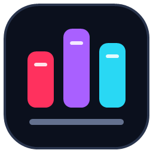

# ROG KB RGB Studio

[简体中文](README.md) · [Download](https://github.com/QKqiuku/ROG-KB-RGB-Studio-FachionACE75HE/releases) · [User guide](docs/USER-GUIDE.md)

An unofficial lighting studio for the **ROG Falchion Ace 75 HE**, controlling its 83 keys, 12 top-strip segments and ROG eye lighting zone.

## Features

- **Built-in effects**: waves, fire, aurora, fireworks and more, with colors, speed, brightness, effect-specific settings and a reset-to-defaults button.
- **Key-reactive lighting**: ripples, spotlights, color spreading, lightning and fireworks triggered by physical key presses, usable alongside a base effect.
- **Music sync**: spectrum bars, a classic equalizer, sound waves, Solar rhythm and more. Capture system audio or a chosen application process, then adjust sensitivity, decay and colors.
- **Custom compositions**: click or drag-select keys into regions, give each region its own colors, effects and settings, and combine custom layers with a base effect.
- **Strip and eye control**: follow the keys below, calculate effects at independent positions, or edit them separately in Custom mode. The strip also supports individual segment selection and music sync.
- **Overall effects**: control the opacity of a complete custom composition with steady output, breathing or beat flashes.
- **My Effects library**: name and save complete compositions, load them like presets, then edit, save or delete them.
- **ATK lighting gallery**: browse, preview and import matching-layout keyframe animations, sorted by newest or hottest.
- **GIF animations**: Full imports, crops and converts GIFs; both versions play previously converted animations.
- **Live previews**: the keyboard reflects the last successfully sent lighting frame, with an additional continuous canvas for music effects. Choose 15 / 30 / 45 / 60 FPS.
- **Three UI languages**: Simplified Chinese, Traditional Chinese and English, selected from the system language.

## Download and start

Currently supports **Windows 10/11 x64 and the wired Falchion Ace 75 HE ANSI 83-key layout**. Windows ARM64, 32-bit Windows, macOS and Linux packages are not available. No separate .NET installation is needed.

Choose a package from [Releases](https://github.com/QKqiuku/ROG-KB-RGB-Studio-FachionACE75HE/releases):

| Version | Choose it when… |
| --- | --- |
| **Full** | You want to import and convert new GIFs |
| **Lite** | You want a smaller download without GIF conversion; other effects, ATK and existing animation playback remain available |

1. Extract the entire archive; keep the EXE with the accompanying files.
2. Connect the keyboard and close other software controlling its lighting.
3. Double-click `RSS_II_RGB.App.exe` or `Start-Studio.cmd` and manually confirm the administrator prompt.
4. Wait for the connection, then select a preset to start.

## How to use

- **Presets**: choose a regular, reactive, music or animation effect and adjust its parameters on the right.
- **Custom compositions**: enter Custom, choose a base effect (or Off), select keys and create regions. Open the region effect settings to adjust the effect and palette independently.
- **Decorative lighting**: switch the strip or eye to Custom and select its zone to edit. Strip segments can also be selected individually.
- **Save your work**: enter a name in My Effects and save. Load, edit and save it again whenever you like.
- **Music effects**: choose a music preset, select system audio or a target process, then adjust sensitivity for your music. Process capture requires Windows build 20348+.
- **Exit**: closing or minimizing hides the app to the tray while playback continues. Use Exit and Restore or tray Exit to stop and attempt to restore the original lighting.

Exit normally before upgrading or switching between Full and Lite. Settings and assets are stored under `%LOCALAPPDATA%\RSS_II_RGB`; preserve that directory to keep your compositions and animations. See the [user guide](docs/USER-GUIDE.md) for more.

Based on [bbfox0703/RSS_II_RGB](https://github.com/bbfox0703/RSS_II_RGB), licensed under [GPL-3.0](LICENSE). Not an official ASUS, ROG or ATK application.
