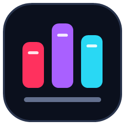

# ROG KB RGB Studio

[English](README.en.md) · [下载应用](https://github.com/QKqiuku/ROG-KB-RGB-Studio-FachionACE75HE/releases) · [详细使用指南](docs/USER-GUIDE.md)

为 **ROG Falchion Ace 75 HE（魔导士 75 HE）** 制作的非官方键盘灯效工作台，支持 83 个按键、顶部 12 段灯条和 ROG 眼睛灯区。

## 为什么开发这个项目

对我来说，奥创为了提供完整的设备管理和生态功能，显得过于臃肿。它的灯光编排更侧重音频同步和多设备联动，对于没有 ROG 全家桶、只想折腾键盘灯光的用户，这些功能的实际用处有限。

具体到键盘，官方工具提供的光效预设较少，自定义设置的上限也没有满足我的需求；网页驱动虽然使用方便，灯效选择同样有限。我希望能够自由组合效果、划分按键区域、单独编排灯条和眼睛，并保存自己的作品。

因此，我基于开源项目继续开发了 ROG KB RGB Studio，把重点放在单把键盘的灯效创作上：提供更多预设、更细的参数调整、区域与图层编排，以及按键交互、音乐联动和逐帧动画播放，让没有整套 RGB 设备的用户，也能充分利用键盘本身的灯光。

## 功能介绍

- **丰富的预设灯效**：波浪、火焰、极光、烟花等效果，可调整颜色、速度、亮度及各效果的专属参数，也可一键恢复当前预设的默认设置。
- **按键交互灯效**：按键涟漪、聚光灯、染色、闪电、烟花等，随真实按键触发，并可与基础灯效一起使用。
- **音乐联动**：频谱柱、经典均衡器、声浪、太阳律动等效果；可选择系统声音或指定应用进程，调节灵敏度、回落和配色。
- **自由编排**：点选或框选按键建立分区，为不同区域设置独立颜色、灯效和参数；在基础灯效上组合自定义层。
- **灯条与眼睛控制**：跟随下方按键、按独立位置计算效果，或在自定义模式中单独编排；灯条支持逐段选取及音乐律动。
- **总体效果**：在自定义模式中统一调节整套编排的透明度，并叠加常亮、呼吸或节拍闪光。
- **保存我的灯效**：为完整编排命名并保存，在左侧像预设一样加载，支持再次编辑、保存及删除。
- **ATK 灯效广场**：浏览、预览并导入与当前键盘配列匹配的逐帧动画，支持最新、最热排序。
- **GIF 动画**：完整版可导入、裁剪和转换 GIF；已转换的动画可在两版中播放。
- **连接监测**：查看连接与灯光发送状态，区分未检测到设备、无法打开接口和灯光控制冲突，支持重新连接及复制诊断信息。
- **实时预览**：键盘预览跟随最后成功发送的灯光帧，音乐效果另有连续画布预览。帧率可选 15 / 30 / 45 / 60 FPS。
- **三种界面语言**：简体中文、繁体中文、英文，跟随系统语言。

## 灯效来源

多数内置预设的灵感来自网络搜索、公开灯效演示，以及 AI 辅助创作、实现和调整。其中部分效果参考了 Lumo 的公开预览，再结合键盘有限的灯位重新实现，因此不保证与参考效果完全一致。

这些灯效会继续根据实体键盘上的表现调整，欢迎反馈效果问题或提出新的创意。

## 支持的键盘与其它选择

本项目目前仅针对 **ROG Falchion Ace 75 HE（魔导士 75 HE），有线连接、ANSI 83 键配列**进行适配，不保证其它 ROG 型号或其它品牌键盘可用。

如果你的键盘尚未适配，可以了解一下 [Lumo](https://lumo.tozero.me/)。它提供丰富的灯效、按键交互和音乐联动功能，也是本项目部分灯效的视觉参考。使用前请先查看其官网的[设备支持查询](https://lumo.tozero.me/srgb.html)，确认具体型号、连接方式和功能限制。Lumo 包含免费功能及付费 Pro 功能。

## 下载与启动

当前支持 **Windows 10/11 x64 + 有线 Falchion Ace 75 HE ANSI 83 键**。暂不提供 Windows ARM64、32 位 Windows、macOS 或 Linux 版本。无需另外安装 .NET。

前往 [Releases](https://github.com/QKqiuku/ROG-KB-RGB-Studio-FachionACE75HE/releases) 选择版本：

| 版本 | 如何选择 |
| --- | --- |
| **Full 完整版** | 需要导入和转换新 GIF 时选择 |
| **Lite 精简版** | 不含 GIF 转换组件，体积更小；其它灯效、ATK 和已有动画播放功能保留 |

1. 完整解压下载的压缩包，不要单独移动 EXE。
2. 连接键盘，并退出其它正在控制键盘灯光的软件。
3. 双击 `RSS_II_RGB.App.exe` 或 `Start-Studio.cmd`，手动确认管理员权限弹窗。
4. 等待连接成功，点击预设即可使用。

## 使用方法

- **使用预设**：选择常规、按键、音乐或动画效果，在右侧调整参数。
- **自定义编排**：进入“自定义”，选择基础灯效（可选“关闭”），点选或框选按键建立区域，通过“区域灯效调整”设置该区域的效果与配色。
- **编辑装饰灯**：将灯条或眼睛切换为“自定义”，选中对应灯区进行编辑；灯条还可以逐段选择。
- **保存作品**：在“我的灯效”输入名称并保存，之后可随时加载、编辑和再次保存。
- **使用音乐效果**：选择音乐预设，指定系统声音或目标进程，再根据音乐调整灵敏度。进程音频采集需要 Windows build 20348+。
- **退出软件**：点 × 或最小化会隐藏到托盘并继续播放；点击“退出并恢复”或托盘 Exit 才会停止并尝试恢复原灯效。

升级或切换 Full / Lite 前先正常退出。设置和素材保存在 `%LOCALAPPDATA%\RSS_II_RGB`，保留该目录即可继续使用已有编排与动画。更多操作见[使用指南](docs/USER-GUIDE.md)。

## 连接异常怎么办

点击顶部状态旁的 **“连接监测”**，可以查看当前连接状态、最近识别的固件、最近成功发送灯光的时间、发送帧数、错误原因和检测到的灯光程序。面板打开时每秒更新连接信息；点击“重新检查”可再次扫描灯光程序。

| 状态或现象 | 原因与处理 |
| --- | --- |
| 等待有线键盘连接 | 尚未找到可用的目标设备。确认型号为已适配的 75 HE，使用 USB 数据线连接，并检查接口或重新插拔。 |
| 已找到键盘，但无法打开 | 设备已被发现，但控制接口无法访问。确认管理员权限弹窗已同意，并检查其它灯光软件及其后台是否仍在运行，然后重新连接。 |
| 灯光控制冲突 | 键盘已处于软件灯光控制模式，可能由其它软件开启，也可能是上次异常退出留下的状态。即使能读到固件，也不代表已经可以发送灯光。 |
| 键盘通信失败 | 查询或灯光发送失败。检查 USB 连接和监测面板中的具体错误，再尝试重新连接。 |
| 旧版一直显示“搜索键盘” | 旧提示可能掩盖控制冲突或通信错误，请先升级到带“连接监测”的版本，再按具体状态排查。 |

遇到灯光控制冲突时：

1. 在本软件点击“退出并恢复”，并退出其它控制键盘灯光的软件；必要时检查其后台是否仍在运行。
2. 拔下键盘 USB，再重新连接，清除可能残留的控制状态。
3. 只打开本软件；若软件仍在运行，可在监测面板点击“重新连接”。该按钮只重试连接，不会强制接管键盘。
4. 如果仍无法恢复，点击“复制诊断信息”，反馈时附上这些信息以及键盘型号、Windows 版本和复现步骤。

检测到 `LightingService`、奥创相关进程、OpenRGB 等程序，只表示它们正在运行，不能据此认定它们占用了键盘。本软件不会自动关闭其它程序或强制覆盖已经启用的灯光控制模式。正常连接后，仅在完整发送第一帧灯光成功时显示“已连接”。

基于 [bbfox0703/RSS_II_RGB](https://github.com/bbfox0703/RSS_II_RGB) 开发，沿用 [GPL-3.0](LICENSE)。非 ASUS、ROG 或 ATK 官方软件。
